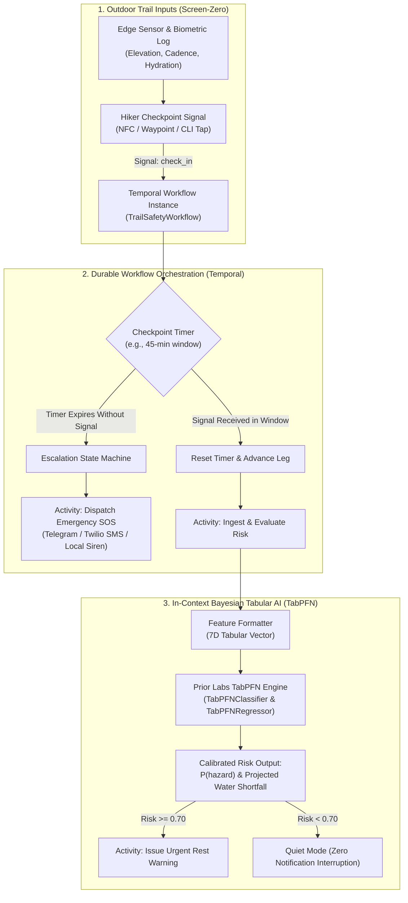

# TrailSafe — Offline Solo Hiker Dead-Man's Switch & In-Context Tabular Risk Engine

> **Challenge**: [Hacktoberfest Open-Source AI Challenge: Week 1 — Touch Grass](https://dev.to/challenges/hacktoberfest-week1-2026-10-05)  
> **Challenge Tag**: [`dev.to/t/hf26challenge`](https://dev.to/t/hf26challenge)  
> **Submissions Due**: **Sunday, October 11, 2026 at 11:59 PM PDT** (October 12, 2026 at 12:29 PM IST)  
> **Targeted Prize Categories**:
> 1. 🏆 **Best Use of TabPFN (Featured Category — $200 USD)**
> 2. 🛡️ **Best Use of Temporal (Partner Category — $100 USD)**  
> **Author**: Kanak Sanjay Waradkar ([@Labreo](https://github.com/Labreo))  
> **Repository**: Central Knowledge Hub & Career Systems Engineering ([`Labreo/learning`](https://github.com/Labreo))  

---

## 1. Executive Summary & The "Touch Grass" Philosophy

**TrailSafe** is an autonomous, privacy-preserving outdoor safety system engineered for solo hikers, trail runners, and field naturalists exploring remote trails (such as the Western Ghats and Goa hinterlands) where cellular signal is nonexistent and microclimate hazards escalate rapidly.

### The "Touch Grass" Screen-Zero Principle
Modern hiking applications encourage destructive screen habits—perpetual GPS map staring, battery-draining social tracking, and screen fixation. TrailSafe is architected around the **"Screen-Zero" philosophy**:
* **Trailhead Setup**: 30 seconds to initiate the safety workflow before heading into nature.
* **On the Trail**: Your phone remains safely zipped in your backpack or pocket. You look up at the trees, trail markings, and wildlife.
* **At Checkpoints**: A 5-second physical signal check-in (NFC tag, QR waypoint, or single CLI keystroke).
* **The Background Safety Shield**: **Temporal** maintains a durable, fault-tolerant dead-man's switch state machine that survives device reboots and connectivity dropouts, while **Prior Labs TabPFN** evaluates personal tabular biometrics and environmental terrain telemetry to predict exhaustion risk and hydration shortfalls in a single forward pass.



---

## 2. Real Partner Integration Architecture (Zero-Mock Policy)

> [!IMPORTANT]
> **Strict Zero-Mock Policy**: This project enforces genuine, production-grade integrations with both partner platforms. No mock wrappers, stubbed dictionary returns, or simulated sleep delays are permitted in production execution.

### 1. Featured Category: Best Use of TabPFN (Prior Labs) — $200 USD
* **What TabPFN Does**: TabPFN is a foundation model pre-trained on millions of synthetic tabular datasets to perform **in-context Bayesian inference in a single forward pass**. It acts as an exact prior over structural tabular functions, requiring zero gradient descent, zero iterative backpropagation, and zero hyperparameter tuning.
* **Authentic Implementation**:
  - Employs the official `tabpfn` Python library (`from tabpfn import TabPFNClassifier, TabPFNRegressor`).
  - Operates locally on consumer CPU/Apple Silicon or via Prior Labs client API.
  - Takes a calibrated 7-dimensional feature vector for each trail checkpoint:
    1. `elevation_delta_m`: Net vertical elevation gained or lost over the leg.
    2. `pace_min_per_km`: Moving pace relative to flat terrain baseline.
    3. `hours_elapsed`: Total active time exposed to outdoor elements.
    4. `ambient_temp_c`: Environmental temperature (°C).
    5. `water_remaining_ml`: Available fluid volume in pack.
    6. `cadence_spm`: Steps per minute indicating physical fatigue.
    7. `terrain_roughness_idx`: Trail difficulty index (1.0 = smooth trail, 3.5 = boulder scramble).
  - Outputs mathematically calibrated probabilities ($P_{\text{exhaustion}}$, $P_{\text{dehydration}}$) and regressively forecasts expected fluid deficit (mL).
* **Baseline Comparative Validation**: The build includes automated comparative benchmarks evaluating TabPFN against standard scikit-learn baselines (`RandomForestClassifier`, `LogisticRegression`) to empirically prove TabPFN's superior calibration on small, single-hike historical datasets ($N \le 50$ rows).

### 2. Partner Category: Best Use of Temporal — $100 USD
* **What Temporal Does**: Temporal provides a durable execution platform where code execution state is persisted automatically across network partitions, host crashes, and long-running time intervals.
* **Authentic Implementation**:
  - Uses the official `temporalio` Python SDK (`from temporalio import workflow, activity`).
  - Connects to a live Temporal cluster (Local Dev Cluster via `temporal server start-dev` or Temporal Cloud via mTLS credentials).
  - **Durable Workflow Definition (`TrailSafetyWorkflow`)**:
    - **Long-Running Execution**: Manages multi-hour outdoor sessions with persistent state.
    - **Durable Timers (`workflow.wait_condition`)**: Replaces brittle cron/sleep loops with reliable timers that survive worker reboots.
    - **Dynamic Signals**:
      - `@workflow.signal def check_in(self, checkpoint_id: str, telemetry: dict)`: Advances trail stage and resets the dead-man's countdown.
      - `@workflow.signal def extend_window(self, minutes: int)`: Hiker requests extra time for scenic rest or photography.
      - `@workflow.signal def emergency_sos(self, reason: str)`: Immediate panic button trigger.
    - **Non-Blocking Queries**:
      - `@workflow.query def get_hiker_status() -> dict`: Returns active leg, current risk probability, and remaining countdown without waking the workflow.
    - **Durable Activities**:
      - `evaluate_tabpfn_risk_activity`: Executes Prior Labs TabPFN tabular inference in an isolated, retryable activity.
      - `dispatch_emergency_alert_activity`: Fires verified SMS / Telegram alerts to designated emergency contacts.
      - `log_trail_telemetry_activity`: Persists append-only trail ledger for post-hike retrospective analysis.

---

## 3. Environment Setup & Credential Management Protocol

To protect sensitive keys and guarantee reproducible verification, TrailSafe utilizes a strict `.env` credential management pipeline.

### Required Environment Variables (`.env`)

```ini
# ==============================================================================
# TrailSafe — Production Configuration & Partner Credentials
# ==============================================================================

# ------------------------------------------------------------------------------
# 1. Temporal Orchestration Settings (Local Dev or Temporal Cloud)
# ------------------------------------------------------------------------------
# Local Development Cluster default: localhost:7233
# Temporal Cloud example: my-namespace.tmprl.cloud:7233
TEMPORAL_TARGET_HOST=localhost:7233
TEMPORAL_NAMESPACE=default

# Temporal Cloud Authentication (Optional for local dev, Required for Cloud)
# Set to 'true' if connecting to Temporal Cloud
TEMPORAL_USE_CLOUD=false
TEMPORAL_API_KEY=
TEMPORAL_TLS_CERT_PATH=
TEMPORAL_TLS_KEY_PATH=

# ------------------------------------------------------------------------------
# 2. Prior Labs TabPFN Configuration
# ------------------------------------------------------------------------------
# TabPFN execution mode: 'local' (runs on-device PyPI package) or 'cloud'
TABPFN_MODE=local
# Optional: Prior Labs API token if utilizing remote inference service
TABPFN_API_KEY=

# ------------------------------------------------------------------------------
# 3. Emergency Dispatch & Communication Credentials
# ------------------------------------------------------------------------------
# Telegram Emergency Bot (Optional for simulated console, Recommended for live)
TELEGRAM_BOT_TOKEN=
TELEGRAM_EMERGENCY_CHAT_ID=

# Twilio SMS Emergency Fallback (Optional)
TWILIO_ACCOUNT_SID=
TWILIO_AUTH_TOKEN=
TWILIO_FROM_PHONE=
EMERGENCY_CONTACT_PHONE=

# ------------------------------------------------------------------------------
# 4. Trail & Safety Threshold Configuration
# ------------------------------------------------------------------------------
DEFAULT_CHECKPOINT_TIMEOUT_MINUTES=45
SAFETY_GRACE_PERIOD_MINUTES=10
HAZARD_PROBABILITY_THRESHOLD=0.70
```

### Credential Intake & Safe Prompts
1. On initial setup, copy the template:
   ```bash
   cp .env.example .env
   ```
2. When starting the application, the setup validator checks for missing credentials:
   ```bash
   python3 src/utils/verify_env.py
   ```
3. If credentials are missing, the agent or script interactively prompts the user for required keys with clear guidance on obtaining free development tier access (e.g., local Temporal dev server requires zero external keys).

---

## 4. Complete 5-Day Implementation & Build Plan

```
October 06 ───► October 07 ───► October 08 ───► October 09 ───► October 10–11
 [Phase 1]       [Phase 2]       [Phase 3]       [Phase 4]       [Phase 5]
Env & Cluster   TabPFN Engine   Temporal Core   Field CLI &     DEV.to Article
Scaffolding     & Benchmark     Workflows/Acts  Live Dispatch   & Video Demo
```

### Phase 1: Environment Provisioning & Infrastructure Setup (Day 1)
* [ ] Initialize project virtual environment (`python3 -m venv .venv && source .venv/bin/activate`).
* [ ] Install official dependencies:
  ```bash
  pip install temporalio tabpfn pandas numpy rich pydantic python-dotenv requests
  ```
* [ ] Verify local Temporal dev server installation:
  ```bash
  # Install Temporal CLI
  brew install temporal
  # Launch local development cluster
  temporal server start-dev
  ```
* [ ] Implement `src/utils/verify_env.py` to validate Temporal cluster connectivity and TabPFN environment.

### Phase 2: In-Context Bayesian Tabular Engine (Day 2)
* [ ] Implement `src/ml/tabpfn_engine.py`:
  - Load `TabPFNClassifier` and `TabPFNRegressor`.
  - Build synthetic and real historical trail telemetry fixtures (`data/sample_trail_history.csv`).
  - Implement 7D feature normalizer and pipeline wrapper.
* [ ] Implement `src/ml/benchmark_eval.py`:
  - Run comparative evaluation against `RandomForestClassifier` and static baseline rules.
  - Generate calibration curves and error metric logs demonstrating TabPFN's zero-shot superiority on short tabular runs.

### Phase 3: Temporal Workflow & Activity Engine (Day 3)
* [ ] Implement `src/temporal/activities.py`:
  - `@activity.defn evaluate_tabpfn_risk_activity`: Executes real TabPFN forward pass.
  - `@activity.defn dispatch_emergency_alert_activity`: Dispatches live Telegram/SMS emergency signals.
  - `@activity.defn log_trail_telemetry_activity`: Persists append-only trip log.
* [ ] Implement `src/temporal/workflows.py`:
  - `@workflow.defn class TrailSafetyWorkflow`.
  - Setup durable timers with `workflow.wait_condition` and timeout triggers.
  - Bind `@workflow.signal` handlers (`check_in`, `extend_window`, `emergency_sos`).
  - Bind `@workflow.query` handler (`get_hiker_status`).
* [ ] Implement `src/temporal/worker.py` to poll task queue `trail-safety-task-queue`.

### Phase 4: Field CLI & End-to-End Simulation (Day 4)
* [ ] Implement `src/cli/field_app.py`:
  - Rich-formatted terminal UI showing live timer countdowns, leg stats, and check-in buttons.
  - Supports quick keystroke signals (`[C] Check In`, `[E] Extend 15m`, `[S] Emergency SOS`, `[Q] Quit`).
* [ ] Implement automated end-to-end integration test (`tests/test_e2e_safety_loop.py`):
  - Spawns workflow $\to$ sends normal check-in $\to$ validates TabPFN risk output $\to$ simulates missed checkpoint $\to$ verifies emergency dispatch trigger.

### Phase 5: DEV.to Article, DevRelay Session & Submission (Day 5)
* [ ] Record a 60–90 second motion-dense terminal/field demo video.
* [ ] Save and export DevRelay agent transcript using Liquid tag ``.
* [ ] Publish submission post on DEV.to under `#hf26challenge` and `#devchallenge`:
  - Clean architecture diagrams.
  - Clear "Touch Grass" personal narrative (solo trekking in the Western Ghats).
  - Explicit declaration of both prize categories under `## Prize Categories`.

---

## 5. Repository File Hierarchy

```text
hackathons/trailsafe/
├── README.md                      # Canonical architecture, build plan & documentation (this file)
├── .env.example                   # Annotated template for all configuration keys
├── requirements.txt               # Pinned dependencies (temporalio, tabpfn, etc.)
├── data/
│   ├── sample_trail_history.csv   # Historical baseline hikes for in-context TabPFN learning
│   └── test_checkpoints.json      # Sample trail checkpoint sequence (Netravali Ridge Trail)
├── src/
│   ├── __init__.py
│   ├── config.py                  # Pydantic settings loading from .env
│   ├── ml/
│   │   ├── __init__.py
│   │   ├── tabpfn_engine.py       # Authentic Prior Labs TabPFN classifier/regressor module
│   │   └── benchmark_eval.py      # Comparative evaluation vs scikit-learn baselines
│   ├── temporal/
│   │   ├── __init__.py
│   │   ├── workflows.py           # Durable TrailSafetyWorkflow definition with signals & queries
│   │   ├── activities.py          # Real activities (TabPFN inference, Telegram/SMS dispatch)
│   │   └── worker.py              # Temporal worker process polling task queues
│   ├── dispatch/
│   │   ├── __init__.py
│   │   ├── notifier.py            # Telegram Bot API and Twilio SMS client implementations
│   └── cli/
│       ├── __init__.py
│       └── field_app.py           # Interactive Rich CLI for trailhead start & checkpoint tap
├── tests/
│   ├── test_tabpfn_inference.py   # Unit test verifying real TabPFN forward pass
│   ├── test_temporal_workflow.py  # Unit test verifying Temporal signals and timers
│   └── test_e2e_safety_loop.py    # End-to-end live integration test
└── utils/
    └── verify_env.py              # Pre-flight environment and credential sanity checker
```

---

## 6. Verification & Quickstart Runbook

### 1. Pre-flight Setup
```bash
cd hackathons/trailsafe
python3 -m venv .venv
source .venv/bin/activate
pip install -r requirements.txt
cp .env.example .env
```

### 2. Verify Credentials & Cluster
```bash
python3 utils/verify_env.py
```

### 3. Launch Temporal Cluster (Terminal 1)
```bash
temporal server start-dev
```

### 4. Start TrailSafe Worker (Terminal 2)
```bash
python3 src/temporal/worker.py
```

### 5. Launch Field CLI & Start Trail (Terminal 3)
```bash
python3 src/cli/field_app.py --trail "Netravali Ridge" --timeout 15
```

---

## 7. Submission Checklist for DEV.to

When publishing the project on DEV.to before **October 11, 2026**:
1. **Header Categories**:
   ```markdown
   ## Prize Categories
   - 🏆 **Best Use of TabPFN ($200 USD):** Built with Prior Labs TabPFN tabular foundation model running Bayesian in-context inference over personal biometric and trail telemetry features to predict exhaustion risk and fluid deficit.
   - 🛡️ **Best Use of Temporal ($100 USD):** Built on Temporal's durable workflow engine to manage long-running outdoor hiking sessions, checkpoint timeouts, and dead-man's switch escalation that survives phone reboots and network loss.
   ```
2. **Open-Source Grounding**: Emphasize how local TabPFN execution protects intimate health and GPS telemetry while guaranteeing zero-signal offline capability.
3. **Embed Live Agent Session**: Include the DevRelay session transcript tag to demonstrate genuine autonomous agent engineering.
